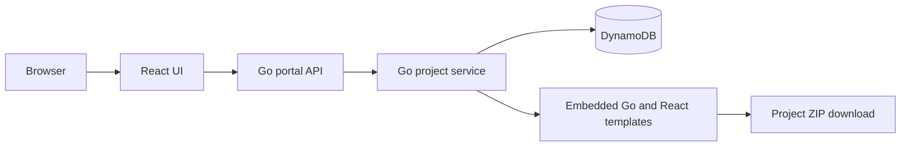

# Launchpad — Internal Developer Portal

Choose a Go or React template, name your project, and download a working starter ZIP. The portal saves project records so you can download them again later.

The local portal uses React, two Go/Gin services, and DynamoDB Local. The AWS deployment uses DynamoDB, three ECR repositories, and EKS created with Terraform. Access to the deployed UI uses `kubectl port-forward` as requested.

## Open the portal

Open **http://127.0.0.1:8080** while the local services are running.

1. Choose **Go + Gin API** or **React Frontend**.
2. Enter a project name containing 3–50 characters.
3. Click **Create project**. A ZIP downloads automatically unless you clear that checkbox.
4. Unzip the download into a new folder and follow its `README.md`.
5. Use **Projects** to find a saved project and download it again.

The portal generates starter source code. Creating a project does not automatically deploy that generated application to AWS.

## Start and stop locally (PowerShell)

Run these commands from `C:\Users\Manish\Downloads\Internal_developer_portal`.

```powershell
.\scripts\Start-Local.ps1
```

This builds the React UI and Go binaries, starts DynamoDB Local on port 8000, starts the project service on port 8082, and starts the portal gateway on port 8080. Windows are hidden; logs are under `.run/`. DynamoDB data is kept in `.run/dynamodb/`.

```powershell
.\scripts\Stop-Local.ps1
```

This stops only recorded processes whose executable and start time match. Saved projects are kept. Stop the old `go run .` server first if it occupies port 8080.

If Java/DynamoDB Local is unavailable, use the local file fallback:

```powershell
.\scripts\Start-Local.ps1 -Storage file
```

File mode stores records in `.run/projects.json`. File and DynamoDB modes have separate data. File mode supports a single project-service process; AWS uses DynamoDB.

This workspace includes portable Node, Java, DynamoDB Local, Terraform, kubectl, AWS CLI, and browser tools in the ignored `.tools/` folder. They are local setup artifacts, not committed application dependencies. On a fresh checkout, install Go, Node 24, Docker Desktop, Terraform, AWS CLI v2, and kubectl. Use Docker Compose for the complete local database setup, or file mode for Go/Node development. A local DynamoDB JAR requires Java 17 or newer: [AWS download instructions](https://docs.aws.amazon.com/amazondynamodb/latest/developerguide/DynamoDBLocal.DownloadingAndRunning.html).

## How the parts fit together



| Folder | Purpose |
| --- | --- |
| `frontend/` | React interface, Vite build, browser checks, Nginx container |
| `backend/portal-api/main.go` | Portal gateway; forwards `/api/` requests to the project service |
| `backend/portal-api/cmd/project-service/` | Separate service that validates, generates, and saves projects |
| `backend/portal-api/internal/projects/` | ZIP generation, storage adapters, and API handlers |
| `backend/portal-api/templates/` | Go and React starter templates embedded in the service binary |
| `infra/terraform/` | AWS networking, EKS, IAM, ECR, and DynamoDB configuration |
| `infra/kubernetes/` | Private services, deployments, health checks, and DynamoDB service account |
| `scripts/` | Local startup/shutdown, downloaded-starter checks, AWS deployment |

The Go services share one Go module but run as separate processes/containers. Use `go run .` for the gateway and `go run ./cmd/project-service` for the project service, from `backend/portal-api`. The gateway requires the project service to handle API requests.

## API links and commands

These GET links work directly in a browser while the portal is running:

| Link | What it checks |
| --- | --- |
| http://127.0.0.1:8080/ | Portal interface |
| http://127.0.0.1:8080/healthz | Gateway process is alive |
| http://127.0.0.1:8080/readyz | Project service and storage are reachable |
| http://127.0.0.1:8080/api/status | Current storage mode |
| http://127.0.0.1:8080/api/templates | Available templates |
| http://127.0.0.1:8080/api/templates/go-gin-api | Go starter details |
| http://127.0.0.1:8080/api/templates/react-frontend | React starter details |
| http://127.0.0.1:8080/api/projects | Saved projects, up to 100 per page |

Create a record using a POST request:

```powershell
$body = @{ name = 'payments-api'; templateId = 'go-gin-api' } | ConvertTo-Json
$result = Invoke-RestMethod -Method Post -Uri 'http://127.0.0.1:8080/api/projects' -ContentType 'application/json' -Body $body
$result.project
Invoke-WebRequest -UseBasicParsing -Uri ('http://127.0.0.1:8080' + $result.project.downloadUrl) -OutFile 'payments-api.zip'
```

`POST /api/projects` returns HTTP 201 and the saved project. `POST /api/projects/download` creates a record and returns a ZIP directly. `GET /api/projects/{id}` returns its record; `GET /api/projects/{id}/download` returns its ZIP. Missing projects return 404; invalid input returns 400. The JSON body limit is 64 KiB. Names are escaped for JavaScript and never used as archive paths or Go module names.

List pagination accepts `limit=1..100` and an opaque `cursor`. Pass the returned `nextCursor` into the next request. DynamoDB uses a paginated scan; records are sorted by creation time within each returned page. This practice implementation has no global full-text search or total-count query; search covers loaded records.

Template version `1.0.0` is saved with every project. Downloads are recreated from embedded templates. Keep historical template versions when introducing future template revisions so old downloads remain reproducible.

## Check the code

```powershell
cd backend\portal-api
go test ./...
go vet ./...
```

With DynamoDB Local running, include the real storage integration test:

```powershell
$env:TEST_DYNAMODB_ENDPOINT = 'http://127.0.0.1:8000'
go test ./...
Remove-Item Env:TEST_DYNAMODB_ENDPOINT
```

Browser checks, from `frontend/`, using the portable Node installed in this workspace:

```powershell
$env:PATH = (Resolve-Path '..\.tools\node-v24.21.0-win-x64').Path + ';' + $env:PATH
$env:PLAYWRIGHT_BROWSERS_PATH = (Resolve-Path '..\.tools\playwright-browsers').Path
npm run test:e2e
```

They create two test projects and save actual downloads and screenshots to `.run/browser/`. Then run this from the repository root:

```powershell
.\scripts\Verify-Starters.ps1
```

It unzips the browser downloads, builds the Go starter, checks its `/healthz` response, installs/builds the React starter, and audits its dependencies. Test records remain in the local database for inspection.

## Run containers

After Docker Desktop is installed and running with Linux containers:

```powershell
docker compose up --build -d
```

Open http://127.0.0.1:8083. Compose runs DynamoDB Local, the project service, the gateway, and the frontend. The UI is bound to your local computer. DynamoDB uses a named volume.

The gateway and frontend wait for their dependencies to pass readiness checks. To wait for the entire stack during verification, use `docker compose up --build -d --wait --wait-timeout 180`.

For the full container check using the tools already in this workspace, run `.\scripts\Verify-Containers.ps1`. It builds the stack, waits for readiness, checks the actual UI in Chromium, and builds the downloaded Go and React starters.

```powershell
docker compose logs
docker compose down
```

`down` stops the containers while keeping their database volume. Docker Desktop needs a supported Windows setup and WSL 2 or Hyper-V: [Docker Windows setup](https://docs.docker.com/desktop/setup/install/windows-install/).

If Docker reports that WSL is missing, run `scripts/Setup-WSL.ps1` from a PowerShell window opened with **Run as administrator**. It enables Virtual Machine Platform and installs WSL using the verified offline installer in `.tools/wsl.msi` when available. It writes setup logs under `.run/` and never restarts Windows itself. Save your work and restart Windows after successful setup, then open Docker Desktop. [Microsoft WSL setup](https://learn.microsoft.com/en-us/windows/wsl/install)

## Deploy privately to AWS

Target account: **316865756899**. Target region: **ap-south-1 (Mumbai)**. `ap-south-1-del-1` is the Delhi Local Zone group under that parent region: [AWS zone reference](https://docs.aws.amazon.com/local-zones/latest/ug/available-local-zones.html).

First complete AWS sign-in. The portable CLI is available in this workspace:

```powershell
& '.\.tools\aws\Amazon\AWSCLIV2\aws.exe' login --profile portal --region ap-south-1
& '.\.tools\aws\Amazon\AWSCLIV2\aws.exe' sts get-caller-identity --profile portal --region ap-south-1
```

Complete the browser sign-in yourself. Use an IAM user/role with permissions to create the VPC, IAM roles, EKS, ECR, DynamoDB, and CloudWatch resources. `aws login` may require the `SignInLocalDevelopmentAccess` policy. If your organization uses IAM Identity Center, use its configured SSO profile instead. [AWS authentication guide](https://docs.aws.amazon.com/cli/latest/userguide/cli-configure-sign-in.html)

EKS Kubernetes access uses the IAM user/role granted an access entry. If the profile used for Terraform is the account owner, authenticate an IAM user or role into a separate profile, for example `portal-eks`, and pass `-KubernetesProfile portal-eks` to `Deploy-AWS.ps1`. The script verifies that this profile belongs to the same account and matches `AdminPrincipalArn` before deploying. Its generated kubeconfig then uses that IAM profile for kubectl.

The AWS plan creates a practice EKS cluster with one managed worker node across two standard availability-zone subnets. Nodes have public addresses for outbound access; no application LoadBalancer is created. The Kubernetes API is restricted to the administrator's public `/32` IP and also supports private access. The project service receives table-scoped DynamoDB permissions through its Kubernetes service account; AWS access keys are not placed in manifests.

EKS, EC2, storage, logging, and public IPv4 addresses can incur ongoing charges. This is a practice deployment with shared project records and private access; organization login, per-user authorization, custom DNS, and a production availability design are later work.

Use your actual IAM user/role ARN and your public IPv4 address below. A value returned by STS containing `assumed-role` is a session ARN; supply the corresponding `arn:aws:iam::316865756899:role/...` role ARN instead.

```powershell
.\scripts\Deploy-AWS.ps1 -Profile portal -Region ap-south-1 -AdminPrincipalArn 'arn:aws:iam::316865756899:role/YOUR_ROLE' -AdminCidr 'YOUR_PUBLIC_IP/32'
```

This checks sign-in/account, initializes Terraform, validates configuration, and saves a plan under `.run/aws.tfplan`. The `-Apply` command checks Docker and builds all three images before creating billable infrastructure, then pushes images and deploys all services:

```powershell
.\scripts\Deploy-AWS.ps1 -Profile portal -Region ap-south-1 -AdminPrincipalArn 'arn:aws:iam::316865756899:role/YOUR_ROLE' -AdminCidr 'YOUR_PUBLIC_IP/32' -Apply
```

Once rollouts pass, access it privately in another terminal:

```powershell
& '.\.tools\kubectl.exe' --kubeconfig '.\.run\eks-kubeconfig' -n portal port-forward service/frontend 8090:8080 --address 127.0.0.1
```

Open http://127.0.0.1:8090. Set `PORTAL_TEST_URL=http://127.0.0.1:8090` and rerun the frontend browser checks against EKS to verify the actual cloud deployment. Keep the port-forward terminal open during use.

If your public IP changes, update the Terraform administrator CIDR before using kubectl. Terraform state stays local in `infra/terraform/` and is ignored by Git; keep it secure and backed up. Team deployments should use a separately configured remote state backend.

To retire this practice deployment, review its Terraform destroy plan first. DynamoDB deletion protection must be explicitly disabled after preserving required records, and ECR repositories must be emptied before deletion. No cleanup command is run automatically.

See [IMPLEMENTATION_STATUS.md](IMPLEMENTATION_STATUS.md) for what has actually been verified and what remains blocked.
